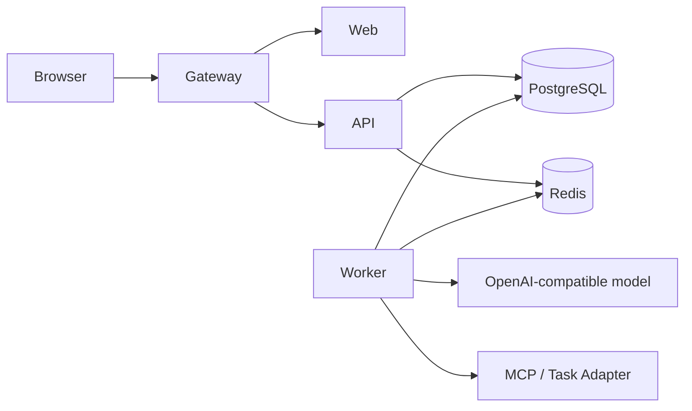

# Council

**自架式多 Agent 會議與任務平台 · Self-hosted multi-agent meetings that turn discussion into accountable work**

[](https://github.com/moegundam/Council/actions/workflows/ci.yml)
[](LICENSE)
[](package.json)
[](docs/SUPPORT.md)


> 畫面使用本倉庫的合成示範資料，不含正式環境、私人帳號或真實會議內容。<br>
> Screenshots use synthetic repository data and contain no production account or real meeting content.

## 中文版

Council 把多 Agent 討論、人工治理、決議、任務與證據放在同一個自架工作區。它適合想自行控制模型、資料與部署環境的開發者、研究團隊及小型技術團隊。

產品主線是：

**目標 → 議程 → 多 Agent 討論 → 人工核准決議 → Task → Evidence／History**

Council 不附模型、託管帳號或固定供應商。你可以接入自己的 OpenAI-compatible 模型服務，設定 Agent 的 Role、Prompt、Skill、MCP 工具與執行邊界。

### 可以做什麼

| 範圍 | 能力 |
|---|---|
| 討論與會議 | 群組／分類／話題、議程、主席主持、自由討論、固定流程、暫停與續行 |
| 決議治理 | 將 Agent 建議轉成可審核決議，由人員核准或拒絕 |
| 任務閉環 | 從決議建立 Task，追蹤待辦、進行中、審查、完成、Evidence 與 History |
| Agent 管理 | Agent、Team、Meeting Preset、Runtime、Model Connector、Credential、Prompt、Skill、MCP |
| 權限與安全 | Owner 管理、人工核准邊界、秘密檔案掛載、安全預設與隔離設定 |
| 外部整合 | OpenAI-compatible 模型、MCP、Reference Task Adapter；專用 Adapter 可自行擴充 |

### 一次完整的使用流程

1. **設定資源**：在「設定」建立模型連接、API 金鑰、Role、Prompt、Skill 與 MCP 工具。
2. **組成 Agent**：替 Agent 綁定 Runtime、模型、角色、可用工具和資料範圍；未完成的必要設定會顯示檢查狀態。
3. **建立話題與議程**：設定會議目標、參與者、主持方式及需要完成的議程項目。
4. **進行討論與治理**：Agent 依會議模式提出意見；Owner 在介面中核准或拒絕決議建議。
5. **追蹤執行**：核准的決議可形成 Task，Worker 執行後留下 Evidence 與 History，方便回看來源。

### 使用畫面

<table>
  <tr>
    <td width="50%"></td>
    <td width="50%"></td>
  </tr>
  <tr>
    <td><strong>Agent 工作區</strong><br>集中查看 Lifecycle、Runtime、Model、Credential、Prompt、Skill 與 MCP 綁定，並顯示尚待處理的設定檢查。</td>
    <td><strong>治理資源</strong><br>管理 Role、Skill、Prompt、模型、API 金鑰、MCP、Task Adapter 與 Harness；實驗功能預設關閉。</td>
  </tr>
</table>

### 選擇啟動方式

| 模式 | 適合用途 | 模型金鑰 | 資料持久化 |
|---|---|---:|---:|
| 合成 demo | 快速瀏覽 UI、資料結構和操作流程 | 不需要 | 否 |
| 完整自架預覽 | 驗證 PostgreSQL、Redis、API、Worker、Web 與 gateway 的完整流程 | 依使用需求 | 是 |

#### 合成 demo

需求：Node.js 22 或 24、pnpm 11.7.0。

```bash
git clone https://github.com/moegundam/Council.git
cd Council
corepack enable
pnpm install --frozen-lockfile
pnpm demo
```

開啟 [http://127.0.0.1:3000](http://127.0.0.1:3000)。Demo 使用記憶體內的合成資料，不會呼叫外部模型，也不代表背景 Worker 已執行。Demo 帳密與 fixture 不得用於正式環境。

#### 完整自架預覽

需求：一般 Linux x86_64 主機、Node.js 22 或 24、pnpm 11.7.0、Docker Engine 與 Compose plugin。

```bash
git clone https://github.com/moegundam/Council.git
cd Council
corepack enable
pnpm install --frozen-lockfile
pnpm selfhost:init
pnpm selfhost:up
printf '%s\n' '至少 12 字元的新密碼' | pnpm selfhost:create-owner -- owner@example.com
```

預設從 [http://127.0.0.1:8787](http://127.0.0.1:8787) 進入 gateway。初始化只建立不存在的設定與 secrets，不覆寫既有檔案；`pnpm selfhost:down` 只停止服務，不刪除資料。

部署前請先檢查 `deploy/.env` 的 `PUBLIC_ORIGIN`、port、UID／GID 與秘密檔案。公開服務應放在受控的 TLS 反向代理後，並先完成備份與還原演練。完整程序見 [自架手冊](docs/SELF_HOSTING.md)。

### 服務組成



| 路徑 | 內容 |
|---|---|
| `apps/web` | 管理介面、討論、會議、任務與文件中心 |
| `apps/api` | API、驗證、管理與會議／任務操作 |
| `apps/worker` | 背景工作、模型呼叫與執行證據 |
| `apps/task-adapter-reference` | 外部 Task Adapter 的參考實作 |
| `apps/mcp-readonly` | 唯讀 MCP 參考服務 |
| `packages/domain` | 會議、決議與任務領域規則 |
| `packages/database` | PostgreSQL schema、migration 與 seed |
| `packages/contracts` | 跨服務型別與契約 |
| `deploy` | Compose、自架初始化、備份、復原與政策測試 |

### 目前狀態

這是 **self-hosted preview**：

- 核心公開能力：討論、議程、三種會議模式、決議、Task／Evidence／History、Agent 與治理資源管理。
- 實驗功能：Goal Run、OMP、Harness、ACS；保留原始碼但預設關閉。
- 尚未承諾：Plane／Jira／Linear 專用 Adapter、任意流程編輯器、多租戶 SaaS、官方託管服務、非 Linux 平台。
- CI：Node.js 22／24、typecheck、單元測試、部署政策測試、build、完整 Git 歷史秘密掃描及瀏覽器 E2E。

### 文件、支援與安全

- [自架、更新與備份](docs/SELF_HOSTING.md)
- [支援範圍](docs/SUPPORT.md)
- [產品與模組功能目錄](docs/product/PRODUCT_AND_MODULE_FUNCTION_CATALOG_2026-07-16.md)
- [威脅模型](docs/OPEN_SOURCE_THREAT_MODEL.md)
- [貢獻指南](CONTRIBUTING.md)
- [安全漏洞回報](SECURITY.md)
- [第三方授權聲明](docs/THIRD_PARTY_NOTICES.md)
- [圖片與資產來源](docs/ASSET_SOURCES.md)

API 開發預設只監聽 `127.0.0.1`；容器才明確設定內部 `0.0.0.0`。Auth bypass、test login、Tailnet quick login、OMP、Harness 與 model tunnel 預設關閉。正式環境請自行提供模型服務與憑證，且不要把 secrets 提交到 Git。

本專案自有程式、文件與合成素材採 [`AGPL-3.0-only`](LICENSE)。第三方內容保留原授權。

## English version

Council brings multi-agent discussion, human governance, decisions, tasks, and evidence into one self-hosted workspace. It is intended for developers, research groups, and small technical teams that want control over their models, data, and deployment environment.

The core workflow is:

**Goal → Agenda → Multi-agent discussion → Human-approved decision → Task → Evidence/History**

Council does not bundle a model, hosted account, or required provider. Connect your own OpenAI-compatible model service, then configure each Agent's role, prompt, skills, MCP tools, and execution boundaries.

### What Council provides

| Area | Capabilities |
|---|---|
| Discussions and meetings | Groups, categories, topics, agendas, chair-led, free-discussion, and fixed-flow meeting modes |
| Decision governance | Turn Agent proposals into reviewable decisions that a human can approve or reject |
| Task loop | Create Tasks from decisions and track pending, active, review, completed, Evidence, and History states |
| Agent management | Agents, Teams, Meeting Presets, runtimes, model connectors, credentials, prompts, skills, and MCP |
| Permissions and safety | Owner administration, human approval boundaries, file-mounted secrets, and secure defaults |
| Integrations | OpenAI-compatible models, MCP, and a Reference Task Adapter that can be extended |

### A complete workflow

1. **Configure resources:** create model connections, API keys, roles, prompts, skills, and MCP tools in Settings.
2. **Assemble Agents:** bind runtime, model, role, tools, and data scope; Council surfaces incomplete setup checks.
3. **Create a topic and agenda:** define the meeting goal, participants, mode, and agenda items.
4. **Discuss and govern:** Agents contribute according to the meeting mode while an Owner approves or rejects decision proposals.
5. **Track execution:** approved decisions become Tasks; Workers attach Evidence and History so the result can be traced back.

### Product tour

<table>
  <tr>
    <td width="50%"></td>
    <td width="50%"></td>
  </tr>
  <tr>
    <td><strong>Agent workspace</strong><br>Review lifecycle, runtime, model, credential, prompt, skill, and MCP bindings, with visible setup checks.</td>
    <td><strong>Governance resources</strong><br>Manage roles, skills, prompts, models, API keys, MCP, Task Adapters, and Harness settings. Experimental features stay off by default.</td>
  </tr>
</table>

### Choose a run mode

| Mode | Best for | Model key | Persistent data |
|---|---|---:|---:|
| Synthetic demo | Exploring the UI, data model, and workflow | Not required | No |
| Full self-hosted preview | Exercising PostgreSQL, Redis, API, Worker, Web, and gateway together | As needed | Yes |

#### Synthetic demo

Requires Node.js 22 or 24 and pnpm 11.7.0.

```bash
git clone https://github.com/moegundam/Council.git
cd Council
corepack enable
pnpm install --frozen-lockfile
pnpm demo
```

Open [http://127.0.0.1:3000](http://127.0.0.1:3000). The demo uses in-memory synthetic data, makes no external model call, and does not claim that a background Worker ran. Never reuse demo credentials or fixtures in production.

#### Full self-hosted preview

Requires a Linux x86_64 host, Node.js 22 or 24, pnpm 11.7.0, Docker Engine, and the Compose plugin.

```bash
git clone https://github.com/moegundam/Council.git
cd Council
corepack enable
pnpm install --frozen-lockfile
pnpm selfhost:init
pnpm selfhost:up
printf '%s\n' 'a-new-password-with-12-or-more-characters' | pnpm selfhost:create-owner -- owner@example.com
```

Open the gateway at [http://127.0.0.1:8787](http://127.0.0.1:8787). Initialization creates only missing configuration and secret files; `pnpm selfhost:down` stops services without deleting data.

Before deployment, review `PUBLIC_ORIGIN`, ports, UID/GID, and secret files in `deploy/.env`. Put any public instance behind a controlled TLS reverse proxy, and prove backup restoration before upgrades. See the [self-hosting guide](docs/SELF_HOSTING.md).

### Service layout


| Path | Purpose |
|---|---|
| `apps/web` | Administration, discussions, meetings, tasks, and documentation |
| `apps/api` | API, authentication, administration, meeting, and task operations |
| `apps/worker` | Background jobs, model calls, and execution evidence |
| `apps/task-adapter-reference` | Reference implementation for external task adapters |
| `apps/mcp-readonly` | Reference read-only MCP service |
| `packages/domain` | Meeting, decision, and task domain rules |
| `packages/database` | PostgreSQL schema, migrations, and seed data |
| `packages/contracts` | Cross-service types and contracts |
| `deploy` | Compose, initialization, backup, recovery, and deployment policy tests |

### Project status

Council is a **self-hosted preview**:

- Core scope: discussions, agendas, three meeting modes, decisions, Task/Evidence/History, Agent management, and governance resources.
- Experimental: Goal Run, OMP, Harness, and ACS source is included but disabled by default.
- Not currently promised: dedicated Plane/Jira/Linear adapters, arbitrary workflow editing, multi-tenant SaaS, a hosted service, or non-Linux platforms.
- CI: Node.js 22/24, type checking, unit tests, deployment policy tests, builds, complete Git-history secret scanning, and browser E2E.

### Documentation, support, and security

- [Self-hosting, upgrades, and backups](docs/SELF_HOSTING.md)
- [Support scope](docs/SUPPORT.md)
- [Product and module catalog](docs/product/PRODUCT_AND_MODULE_FUNCTION_CATALOG_2026-07-16.md)
- [Threat model](docs/OPEN_SOURCE_THREAT_MODEL.md)
- [Contributing](CONTRIBUTING.md)
- [Private security reporting](SECURITY.md)
- [Third-party notices](docs/THIRD_PARTY_NOTICES.md)
- [Image and asset sources](docs/ASSET_SOURCES.md)

The development API binds to `127.0.0.1` by default; containers explicitly use an internal `0.0.0.0` binding. Authentication bypasses, test login, Tailnet quick login, OMP, Harness, and the model tunnel are disabled by default. Production operators provide their own model services and credentials and must never commit secrets.

Project-owned code, documentation, and synthetic assets are licensed under [`AGPL-3.0-only`](LICENSE). Third-party material retains its original terms.
