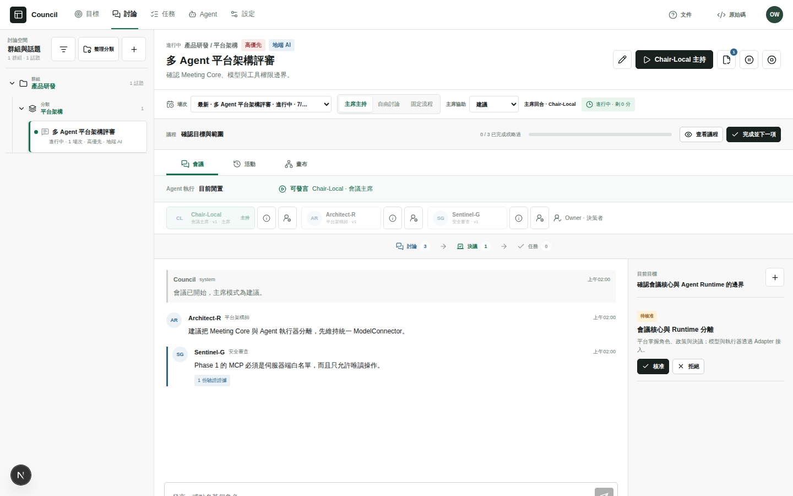
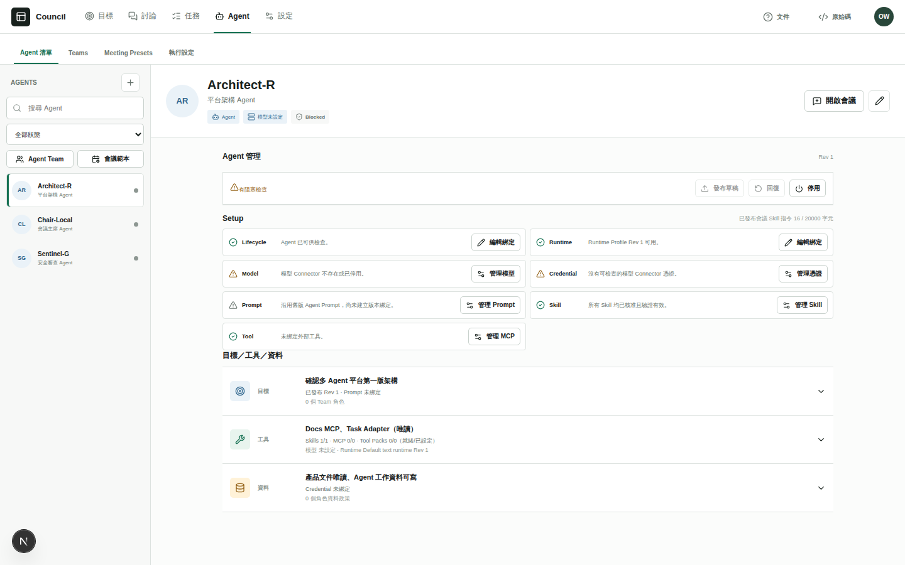
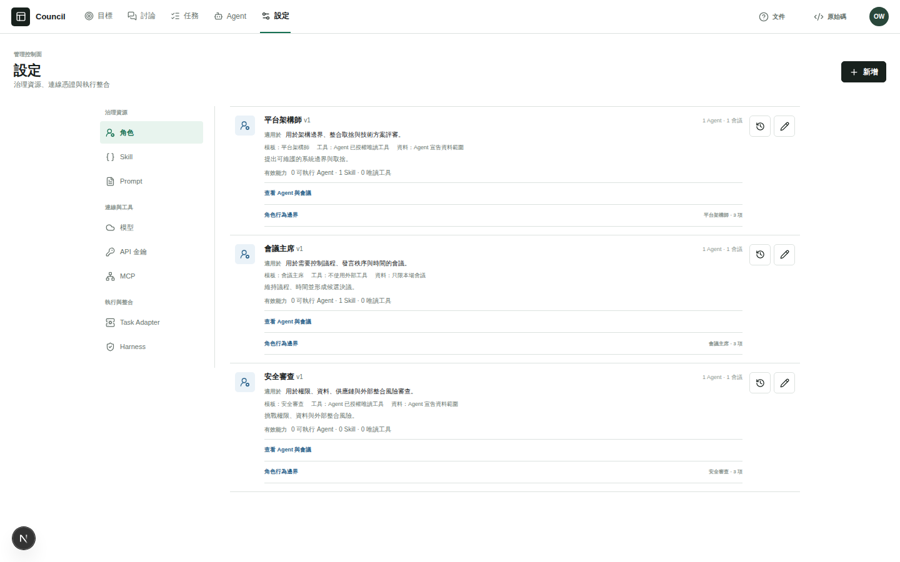
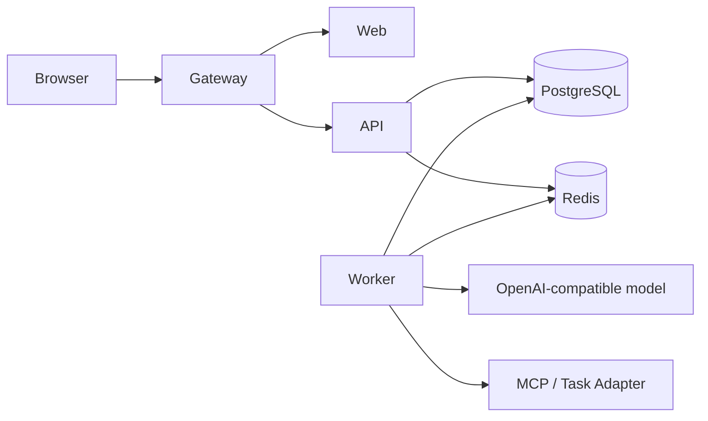

# Council

<p align="right"><a href="README.md">中文</a> · <strong>English</strong></p>

**Self-hosted multi-agent meetings that turn discussion into accountable work**

[](https://github.com/moegundam/Council/actions/workflows/ci.yml)
[](LICENSE)
[](package.json)
[](docs/SUPPORT.md)



> Screenshots use synthetic repository data and contain no production account or real meeting content.

## English

Council brings multi-agent discussion, human governance, decisions, tasks, and evidence into one self-hosted workspace. It is intended for developers, research groups, and small technical teams that want control over their models, data, and deployment environment.

The core workflow is:

**Goal → Agenda → Multi-agent discussion → Human-approved decision → Task → Evidence/History**

Council does not bundle a model, hosted account, or required provider. Connect your own OpenAI-compatible model service, then configure each Agent's role, prompt, skills, MCP tools, and execution boundaries.

### What Council provides

| Area | Capabilities |
|---|---|
| Discussions and meetings | Groups, categories, topics, agendas, chair-led, free-discussion, and fixed-flow meeting modes |
| Decision governance | Turn Agent proposals into reviewable decisions that a human can approve or reject |
| Task loop | Create Tasks from decisions and track pending, active, review, completed, Evidence, and History states |
| Agent management | Agents, Teams, Meeting Presets, runtimes, model connectors, credentials, prompts, skills, and MCP |
| Permissions and safety | Owner administration, human approval boundaries, file-mounted secrets, and secure defaults |
| Integrations | OpenAI-compatible models, MCP, and a Reference Task Adapter that can be extended |

### A complete workflow

1. **Configure resources:** create model connections, API keys, roles, prompts, skills, and MCP tools in Settings.
2. **Assemble Agents:** bind runtime, model, role, tools, and data scope; Council surfaces incomplete setup checks.
3. **Create a topic and agenda:** define the meeting goal, participants, mode, and agenda items.
4. **Discuss and govern:** Agents contribute according to the meeting mode while an Owner approves or rejects decision proposals.
5. **Track execution:** approved decisions become Tasks; Workers attach Evidence and History so the result can be traced back.

### Product tour

<table>
  <tr>
    <td width="50%"></td>
    <td width="50%"></td>
  </tr>
  <tr>
    <td><strong>Agent workspace</strong><br>Review lifecycle, runtime, model, credential, prompt, skill, and MCP bindings, with visible setup checks.</td>
    <td><strong>Governance resources</strong><br>Manage roles, skills, prompts, models, API keys, MCP, Task Adapters, and Harness settings. Experimental features stay off by default.</td>
  </tr>
</table>

### Choose a run mode

| Mode | Best for | Model key | Persistent data |
|---|---|---:|---:|
| Synthetic demo | Exploring the UI, data model, and workflow | Not required | No |
| Full self-hosted preview | Exercising PostgreSQL, Redis, API, Worker, Web, and gateway together | As needed | Yes |

#### Synthetic demo

Requires Node.js 22 or 24 and pnpm 11.7.0.

```bash
git clone https://github.com/moegundam/Council.git
cd Council
corepack enable
pnpm install --frozen-lockfile
pnpm demo
```

Open [http://127.0.0.1:3000](http://127.0.0.1:3000). The demo uses in-memory synthetic data, makes no external model call, and does not claim that a background Worker ran. Never reuse demo credentials or fixtures in production.

#### Full self-hosted preview

Requires a Linux x86_64 host, Node.js 22 or 24, pnpm 11.7.0, Docker Engine, and the Compose plugin.

```bash
git clone https://github.com/moegundam/Council.git
cd Council
corepack enable
pnpm install --frozen-lockfile
pnpm selfhost:init
pnpm selfhost:up
printf '%s\n' 'a-new-password-with-12-or-more-characters' | pnpm selfhost:create-owner -- owner@example.com
```

Open the gateway at [http://127.0.0.1:8787](http://127.0.0.1:8787). Initialization creates only missing configuration and secret files; `pnpm selfhost:down` stops services without deleting data.

Before deployment, review `PUBLIC_ORIGIN`, ports, UID/GID, and secret files in `deploy/.env`. Put any public instance behind a controlled TLS reverse proxy, and prove backup restoration before upgrades. See the [self-hosting guide](docs/SELF_HOSTING.md).

### Service layout



| Path | Purpose |
|---|---|
| `apps/web` | Administration, discussions, meetings, tasks, and documentation |
| `apps/api` | API, authentication, administration, meeting, and task operations |
| `apps/worker` | Background jobs, model calls, and execution evidence |
| `apps/task-adapter-reference` | Reference implementation for external task adapters |
| `apps/mcp-readonly` | Reference read-only MCP service |
| `packages/domain` | Meeting, decision, and task domain rules |
| `packages/database` | PostgreSQL schema, migrations, and seed data |
| `packages/contracts` | Cross-service types and contracts |
| `deploy` | Compose, initialization, backup, recovery, and deployment policy tests |

### Project status

Council is a **self-hosted preview**:

- Core scope: discussions, agendas, three meeting modes, decisions, Task/Evidence/History, Agent management, and governance resources.
- Experimental: Goal Run, OMP, Harness, and ACS source is included but disabled by default.
- Not currently promised: dedicated Plane/Jira/Linear adapters, arbitrary workflow editing, multi-tenant SaaS, a hosted service, or non-Linux platforms.
- CI: Node.js 22/24, type checking, unit tests, deployment policy tests, builds, complete Git-history secret scanning, and browser E2E.

### Documentation, support, and security

- [Self-hosting, upgrades, and backups](docs/SELF_HOSTING.md)
- [Support scope](docs/SUPPORT.md)
- [Product and module catalog](docs/product/PRODUCT_AND_MODULE_FUNCTION_CATALOG_2026-07-16.md)
- [Threat model](docs/OPEN_SOURCE_THREAT_MODEL.md)
- [Contributing](CONTRIBUTING.md)
- [Private security reporting](SECURITY.md)
- [Third-party notices](docs/THIRD_PARTY_NOTICES.md)
- [Image and asset sources](docs/ASSET_SOURCES.md)

The development API binds to `127.0.0.1` by default; containers explicitly use an internal `0.0.0.0` binding. Authentication bypasses, test login, Tailnet quick login, OMP, Harness, and the model tunnel are disabled by default. Production operators provide their own model services and credentials and must never commit secrets.

Project-owned code, documentation, and synthetic assets are licensed under [`AGPL-3.0-only`](LICENSE). Third-party material retains its original terms.
